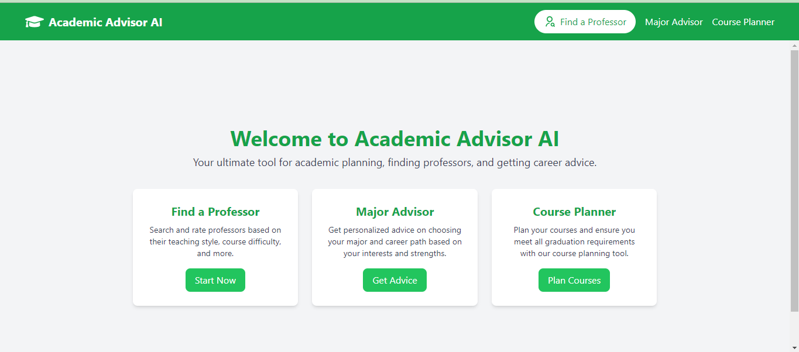
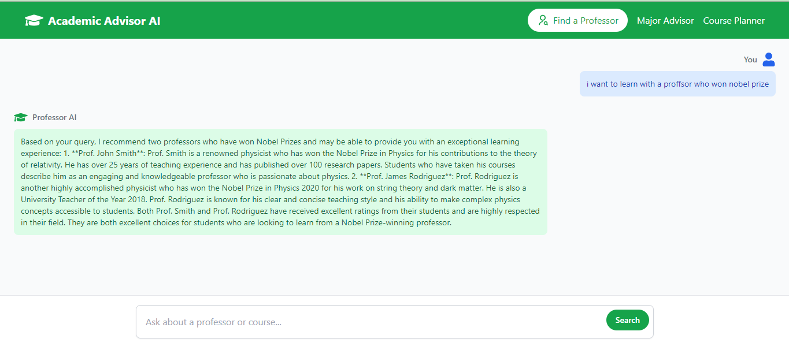
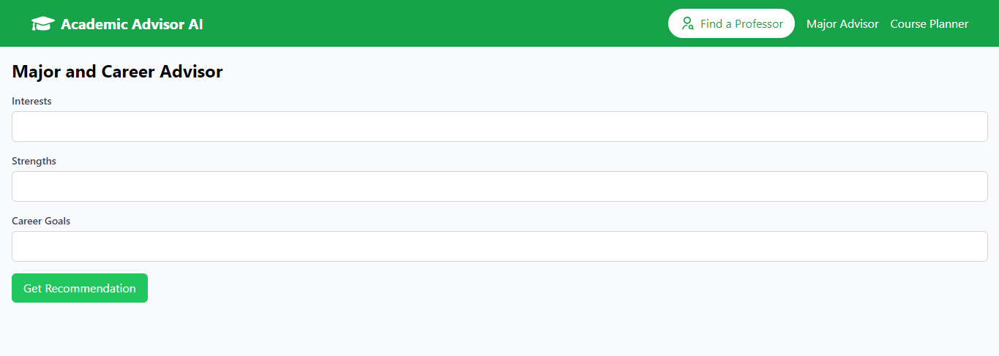
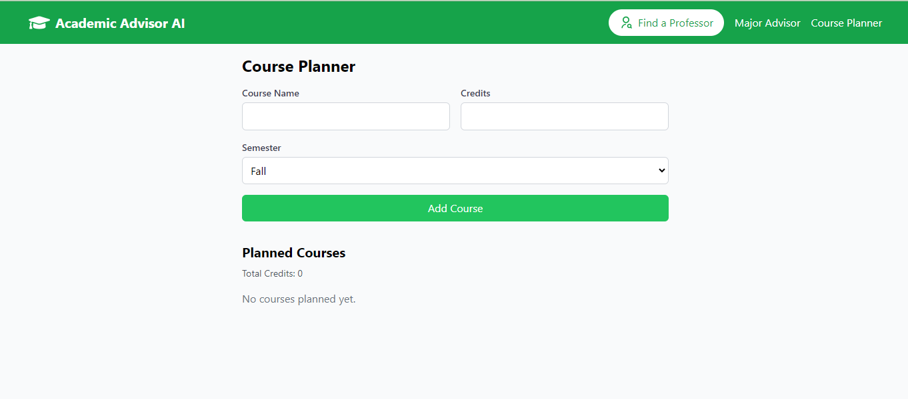

# Academic Advisor AI

An academic-planning application for professor search, major advice, and course planning.



## What it does

- Find professors using a question about a student's interests.
- Ask for major and career-path guidance.
- Use a separate course-planning interface.

## Run locally

You need Node.js and npm. The professor-data loading step also uses Python 3, a Google Generative AI API key, and a Pinecone development project.

```bash
git clone https://github.com/gelftheshot/academic-advisor-ai.git
cd academic-advisor-ai
npm ci
```

Create `.env.local` in the project root:

```dotenv
GOOGLE_GENERATIVE_AI_API_KEY=your_google_api_key
PINECONE_API_KEY=your_pinecone_api_key
```

### Load the professor data

Review `data.json` and use a separate development Pinecone project containing no data you need to keep. The existing `load.py` script deletes an index named `rag-index` if one already exists, then creates and populates that index. Do not run it against a shared or production index.

```bash
python3 -m venv .venv
source .venv/bin/activate
python -m pip install python-dotenv pinecone langchain-community langchain-google-genai
python load.py
```

The loader reads `.env.local`. Its Python dependencies are not version-locked in this repository.

### Start the application

```bash
npm run dev
```

Open [http://localhost:3000](http://localhost:3000).

For a production build:

```bash
npm run build
npm start
```

The AI routes use the provider model configured in `app/api/chat/route.js` and `app/api/majorAdvisor/route.js`. Verify provider access and current model availability when setting up your own environment.

## Screens

| Professor search | Major advisor |
| --- | --- |
|  |  |



## Main files

- `app/api/chat/route.js`: question embedding, retrieval from `rag-index`, and generated professor-search answers.
- `app/api/majorAdvisor/route.js`: generated major-advice responses.
- `app/coursePlanner/page.js`: course-planning interface.
- `load.py`: professor-data preparation and index loading.

[Project write-up](https://www.lihongebre.com/projects/academic-advisor-ai)
